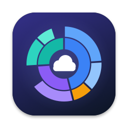
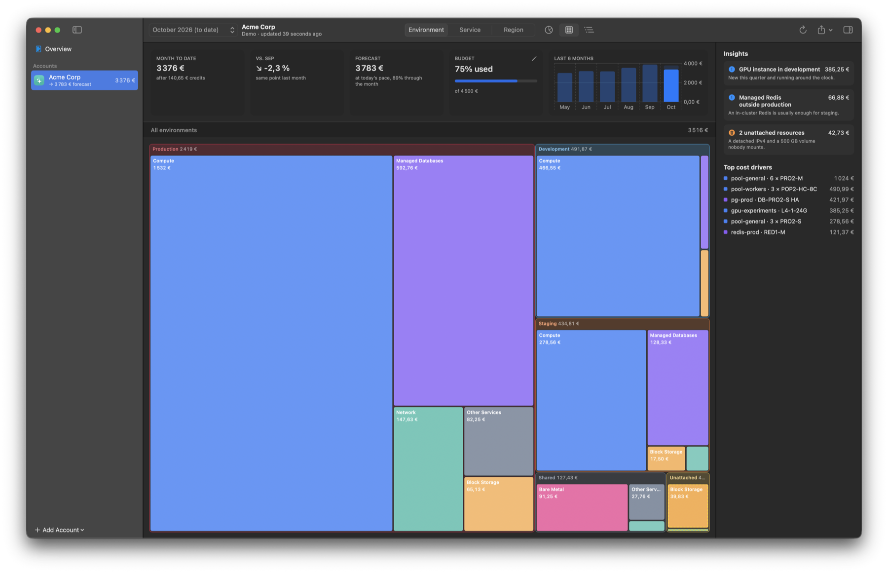

<div align="center">
  
  <h1>Cloud Cost Map</h1>
  <p><strong>See where your cloud money goes — by environment, service and resource.</strong><br>
  A native macOS app with sunburst and treemap views of your cloud bill.</p>
</div>

<p align="center"></p>

---

## Features

| | |
| --- | --- |
| **Sunburst** | Rings from environment → service → resource. Click to zoom in, click the centre to zoom out, hover to trace a segment's path |
| **Treemap** | Two nested levels, squarified so areas compare at a glance; unattached resources get a dashed outline |
| **List** | Expandable table with share bars; filter by name or SKU |
| **Group by** | Environment, Service, Project (Scaleway) or Region (demo) — the same money, cut differently |
| **Allocation** | Scaleway invoice lines are split across the resources that caused them (nodes, volumes, IPs, databases…) using live inventory |
| **Insights** | Unattached resources, non-production compute running 24/7, managed Redis outside prod, Edge Services plans… click one to highlight it in the chart |
| **Inspector** | Cost, share, change vs. last month, largest children, allocation rule and SKUs |
| **Numbers** | Month to date, fair comparison with the same point last month, end-of-month forecast, budget gauge, 1–12 month trend |
| **Accounts** | Several accounts and providers in one sidebar, plus an Overview across all of them |
| **Menu bar** | Month-to-date total, per-account forecast, budget overruns in red |
| **Export** | CSV per view, raw invoice lines, full JSON report, or a pasteable summary |
| **Private** | Secrets stay in the Keychain or your existing `~/.config/scw/config.yaml`; reports are cached locally for instant, offline launch |

### Providers

| Provider | Status |
| --- | --- |
| Scaleway | ✅ Billing API + inventory allocation. Imports CLI profiles in one click |
| Demo | ✅ A fictional company, to try the app without credentials |
| AWS, Azure, Google Cloud | Listed as *coming soon* — see [Adding a provider](#adding-a-provider) |

## Build and run

Requires macOS 15+ and Xcode 16+ (Swift 6).

```bash
make run        # builds build/Cloud Cost Map.app and opens it
make test       # unit tests (no network)
make open       # open the package in Xcode, run the CloudCostMap scheme
make brand      # regenerate the icon and logo
```

Live check against a real Scaleway account (read-only):

```bash
SCW_LIVE_PROFILE=my-profile swift test --filter LiveScaleway
```

### Scaleway permissions

An IAM key with **BillingReadOnly** is enough to see totals. Per-resource allocation also needs read access to the products you use (Instances, Kubernetes, Block Storage, Databases, Load Balancers, IPAM, Domains, Secret Manager…). Anything the key can't list stays in *Shared* or *Unallocated* and is noted in the inspector — totals are never affected.

## Architecture

```
Sources/
  CloudCostCore/            no SwiftUI: reusable from a CLI, widget or another app
    Model/                  CostNode tree, CostReport, BillingPeriod, Account, EnvironmentClassifier
    Providers/              CloudProvider protocol, ProviderKind metadata, ProviderFactory
      Scaleway/             REST client, CLI config reader, inventory fetch, allocation rules
      Demo/                 deterministic fake data
    Layout/                 sunburst partition and squarified treemap geometry (pure, tested)
    Export/                 CSV / JSON
  CloudCostMap/             the macOS app
    App/                    @main scenes, AppModel (state + fetching), Preferences
    Support/                Keychain, on-disk cache, palette and formatting
    Views/                  sidebar, overview, dashboard, charts, inspector, settings, menu bar
Tests/CloudCostCoreTests/   allocation against fixtures, layouts, parsing, opt-in live test
scripts/                    brand.swift (icon + SVG from one geometry), bundle.sh (.app)
```

**The one idea:** every provider produces a `CostReport` holding one or more `CostView`s, each a `CostNode` tree. Everything the user sees — charts, table, inspector, insights, trends, budget, menu bar, export — reads only that. Colours come from each node's `colorKey`, so *Compute* is the same blue in every view, month and account.

**State** lives in `AppModel` (`@Observable`, main actor): accounts, reports per account and month, fetch status. Views never call providers, the Keychain or the disk directly.

### Adding a provider

1. Add a case to `ProviderKind` with its name, symbol, tint and `fields` (what the add-account form asks for), and mark it `isAvailable`.
2. Implement `CloudProvider` — `validate()` and `fetchReports(for:progress:)` — returning reports whose views use the shared ids (`CostView.environment`, `.service`, `.project`, `.region`) where they apply. Use the passed `EnvironmentClassifier` to map names and tags to environments.
3. Build it in `ProviderFactory.make`.
4. Add fixture tests next to `ScalewayAttributionTests`.

## Reusing this as a template

The parts that are not about cloud costs carry over to any macOS app:

- **Package layout** — a UI-free core library, a thin SwiftUI executable, and tests, all in `Package.swift` with no Xcode project to merge.
- **`scripts/bundle.sh` + `Resources/Info.plist`** — a signed `.app` from `swift build`.
- **`scripts/brand.swift`** — icon set, `.icns` and SVG logo from one drawing, reproducible on CI.
- **App shell** — `NavigationSplitView` sidebar + inspector, Settings scene, MenuBarExtra, commands, `Preferences` backed by `UserDefaults`, `KeychainStore`, JSON `Storage` in Application Support.

## Distribution

`bundle.sh` signs ad hoc, which is fine on your own Mac. To share the app, sign with a Developer ID (`codesign --options runtime --sign "Developer ID Application: …"`) and notarize (`xcrun notarytool submit … --wait`, then `xcrun stapler staple`).
