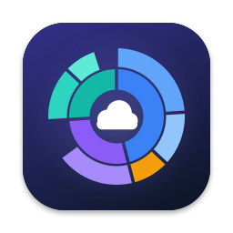
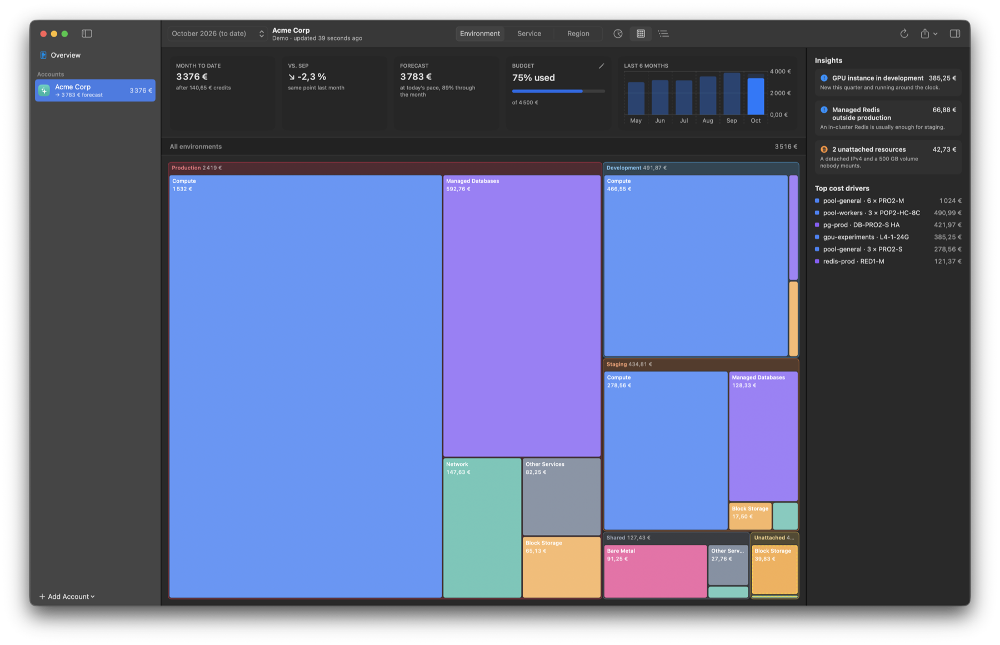

<div align="center">
  
  <h1>Cloud Cost Map</h1>
  <p><strong>See where your cloud money goes — by environment, service and resource.</strong><br>
  A native macOS app with sunburst and treemap views of your cloud bill.</p>
</div>

<p align="center"></p>

---

## Features

| | |
| --- | --- |
| **Sunburst** | Rings from environment → service → resource. Click to zoom in, click the centre to zoom out, hover to trace a segment's path |
| **Treemap** | Two nested levels, squarified so areas compare at a glance; unattached resources get a dashed outline |
| **List** | Expandable table with share bars; filter by name or SKU |
| **Group by** | Environment, Service, Project (Scaleway), Account (AWS) or Region — the same money, cut differently |
| **Allocation** | Scaleway invoice lines are split across the resources that caused them (nodes, volumes, IPs, databases…) using live inventory. AWS costs are placed by an environment cost allocation tag, falling back to linked account names |
| **Insights** | Unattached resources, non-production compute running 24/7, managed Redis outside prod, Edge Services plans, idle Elastic IPs, gp2 volumes, NAT Gateways, egress… click one to highlight it in the chart |
| **Inspector** | Cost, share, change vs. last month, largest children, allocation rule and SKUs |
| **Numbers** | Month to date, fair comparison with the same point last month, end-of-month forecast, budget gauge, 1–12 month trend |
| **Accounts** | Several accounts and providers in one sidebar, plus an Overview across all of them |
| **Menu bar** | Month-to-date total, per-account forecast, budget overruns in red |
| **Export** | CSV per view, raw invoice lines, full JSON report, or a pasteable summary |
| **Private** | Secrets stay in the Keychain or your existing `~/.config/scw/config.yaml` / `~/.aws/credentials`; reports are cached locally for instant, offline launch |

### Providers

| Provider | Status |
| --- | --- |
| Scaleway | ✅ Billing API + inventory allocation. Imports CLI profiles in one click |
| AWS | ✅ Cost Explorer: environment, service → usage type, linked account and region views. Imports CLI profiles that hold access keys |
| Demo | ✅ A fictional company, to try the app without credentials |
| Azure, Google Cloud | Listed as *coming soon* — see [Adding a provider](#adding-a-provider) |

## Install

```bash
brew trust --cask arhunsaday/tap/cloud-cost-map
brew install --cask arhunsaday/tap/cloud-cost-map
```

Or download the DMG from [Releases](https://github.com/arhunsaday/cloud-cost-map/releases/latest) and drag **Cloud Cost Map** into Applications. Universal, macOS 15 or later, signed and notarized.

## Build and run

Requires macOS 15+ and Xcode 16+ (Swift 6).

```bash
make run        # builds build/Cloud Cost Map.app and opens it
make test       # unit tests (no network)
make open       # open the package in Xcode, run the CloudCostMap scheme
make brand      # regenerate the icon and logo
make dmg        # signed, notarized DMG in dist/ (see Distribution)
```

Live check against a real Scaleway account (read-only):

```bash
SCW_LIVE_PROFILE=my-profile swift test --filter LiveScaleway
```

```bash
AWS_LIVE_PROFILE=my-profile AWS_LIVE_TAG=Environment swift test --filter LiveAWS
```

### Scaleway permissions

An IAM key with **BillingReadOnly** is enough to see totals. Per-resource allocation also needs read access to the products you use (Instances, Kubernetes, Block Storage, Databases, Load Balancers, IPAM, Domains, Secret Manager…). Anything the key can't list stays in *Shared* or *Unallocated* and is noted in the inspector — totals are never affected.

### AWS permissions and cost

The key needs only `ce:GetCostAndUsage`. Use the management (payer) account to see every linked account of an organization; a member account sees itself. Cost Explorer must have been opened once in the Billing console.

Environments come from, in order:

1. the **environment tag** set on the account (e.g. `Environment`), which must be [activated as a cost allocation tag](https://docs.aws.amazon.com/awsaccountbilling/latest/aboutv2/activating-tags.html) — it applies from activation onwards;
2. the **linked account name** (`acme-prod`, `acme-staging`), matched against the keywords in Settings → Environments.

Untagged costs in an account whose name matches nothing land in *Unallocated*.

AWS bills **USD 0.01 per Cost Explorer request**. A refresh fetches every loaded month at once in 4 requests, or 6 with an environment tag; *Test Connection* makes one. Cost Explorer data only updates a few times a day, so automatic refreshes of AWS accounts happen at most every 6 hours (about USD 5–7 a month per account if the app runs all day; *Every day* is about USD 1.20–1.80). Manual refreshes are not limited.

CLI profiles are read from `~/.aws/credentials` and `~/.aws/config` (or `AWS_SHARED_CREDENTIALS_FILE` / `AWS_CONFIG_FILE`) on every refresh. Only profiles holding access keys are supported; for SSO or role profiles, use an IAM user key with the policy above.

## Architecture

```
Sources/
  CloudCostCore/            no SwiftUI: reusable from a CLI, widget or another app
    Model/                  CostNode tree, CostReport, BillingPeriod, Account, EnvironmentClassifier
    Providers/              CloudProvider protocol, ProviderKind metadata, ProviderFactory
      Scaleway/             REST client, CLI config reader, inventory fetch, allocation rules
      AWS/                  SigV4 signer, Cost Explorer client, CLI profile reader, attribution
      Demo/                 deterministic fake data
    Layout/                 sunburst partition and squarified treemap geometry (pure, tested)
    Export/                 CSV / JSON
  CloudCostMap/             the macOS app
    App/                    @main scenes, AppModel (state + fetching), Preferences
    Support/                Keychain, on-disk cache, palette and formatting
    Views/                  sidebar, overview, dashboard, charts, inspector, settings, menu bar
Tests/CloudCostCoreTests/   allocation against fixtures, layouts, parsing, opt-in live test
scripts/                    brand.swift (icon + SVG from one geometry), bundle.sh (.app), release.sh + distribute.sh (DMG)
```

**The one idea:** every provider produces a `CostReport` holding one or more `CostView`s, each a `CostNode` tree. Everything the user sees — charts, table, inspector, insights, trends, budget, menu bar, export — reads only that. Colours come from each node's `colorKey`, so *Compute* is the same blue in every view, month and account.

**State** lives in `AppModel` (`@Observable`, main actor): accounts, reports per account and month, fetch status. Views never call providers, the Keychain or the disk directly.

### Adding a provider

1. Add a case to `ProviderKind` with its name, symbol, tint, `fields` (the credentials the add-account form asks for) and `options` (settings asked whatever the credential source), and mark it `isAvailable`.
2. Implement `CloudProvider` — `validate()` and `fetchReports(for:progress:)` — returning reports whose views use the shared ids (`CostView.environment`, `.service`, `.project`, `.region`) where they apply. Use the passed `EnvironmentClassifier` to map names and tags to environments.
3. Build it in `ProviderFactory.make`.
4. Add fixture tests next to `ScalewayAttributionTests` and `AWSAttributionTests`.

## Reusing this as a template

The parts that are not about cloud costs carry over to any macOS app:

- **Package layout** — a UI-free core library, a thin SwiftUI executable, and tests, all in `Package.swift` with no Xcode project to merge.
- **`scripts/bundle.sh` + `Resources/Info.plist`** — a signed `.app` from `swift build`; `scripts/distribute.sh` turns any `.app` into a notarized DMG.
- **`scripts/brand.swift`** — icon set, `.icns` and SVG logo from one drawing, reproducible on CI.
- **App shell** — `NavigationSplitView` sidebar + inspector, Settings scene, MenuBarExtra, commands, `Preferences` backed by `UserDefaults`, `KeychainStore`, JSON `Storage` in Application Support.

## Distribution

Releases are DMGs signed with a **Developer ID** and **notarized** by Apple, so they open on any Mac
with no Gatekeeper warning. Builds are universal (Apple Silicon + Intel).

| Script | What it does |
| --- | --- |
| [`scripts/release.sh`](scripts/release.sh) `[version]` | Universal release bundle (`bundle.sh`), then `distribute.sh` → `dist/Cloud-Cost-Map-<version>.dmg` |
| [`scripts/distribute.sh`](scripts/distribute.sh) `<app> <dmg>` | Developer ID signature with the hardened runtime, notarizes and staples the app, wraps it in a DMG, signs, notarizes and staples the DMG |

`distribute.sh` is identical in [timelet](https://github.com/arhunsaday/timelet). `make dmg VERSION=1.0.0` is a shortcut for `scripts/release.sh 1.0.0`.

### One-time setup on your Mac

1. **Certificate.** Xcode → Settings → Accounts → your team → **Manage Certificates…** → **+** →
   **Developer ID Application**. Only the team's Account Holder can create one.
2. **Notarization credentials**, stored in the login keychain under the profile name `notary`.
   Create an app-specific password at [account.apple.com](https://account.apple.com) (Sign-In and
   Security → App-Specific Passwords), find your Team ID at
   [developer.apple.com/account](https://developer.apple.com/account) (Membership details), then:

   ```bash
   xcrun notarytool store-credentials notary --apple-id you@example.com --team-id ABCDE12345
   ```

### Building a release by hand

```bash
scripts/release.sh 1.2.0
```

`NOTARIZE=0 scripts/release.sh` signs without notarizing, for a quick check (other Macs will block that
DMG). `DEVELOPER_ID="Developer ID Application: …"` picks an identity if you have several.

Publish it by attaching the DMG to a GitHub Release (Releases → Draft a new release, tag `v1.2.0`).
Then set `version` and `sha256` in [`Casks/cloud-cost-map.rb`](https://github.com/arhunsaday/homebrew-tap/blob/main/Casks/cloud-cost-map.rb) of the Homebrew tap.

### CI

[`release.yml`](.github/workflows/release.yml) runs the same script on a `macos-15` runner and publishes
a GitHub Release. Trigger it by pushing a tag; the version is taken from the tag name:

```bash
git tag v1.2.3
git push origin v1.2.3
```

Or **Actions → Release → Run workflow**, enter the version and tick **publish**. Leaving **publish**
unticked builds and uploads the DMG as a workflow artifact only. A version with a hyphen
(`v1.2.3-rc1`) is published as a pre-release.

`release.yml` needs these repository secrets (Settings → Secrets and variables → Actions):

| Secret | Value |
| --- | --- |
| `DEVELOPER_ID_P12` | The Developer ID Application certificate **with its private key**, exported from Keychain Access as `.p12`, then base64: `base64 -i DeveloperID.p12 \| pbcopy` |
| `DEVELOPER_ID_P12_PASSWORD` | The password chosen during that export |
| `NOTARY_KEY_P8` | Contents of an App Store Connect API key `AuthKey_XXXXXX.p8` (Users and Access → Integrations → Team Keys, role *Developer*) |
| `NOTARY_KEY_ID` | That key's ID |
| `NOTARY_ISSUER_ID` | The Issuer ID shown above the key list |
